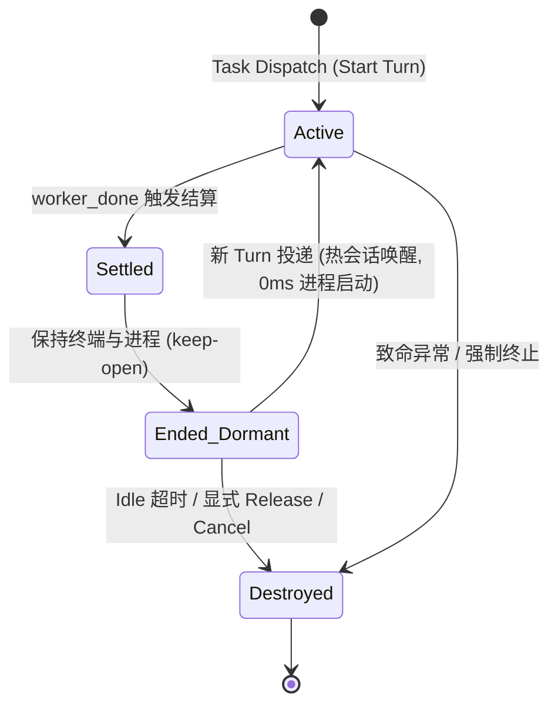
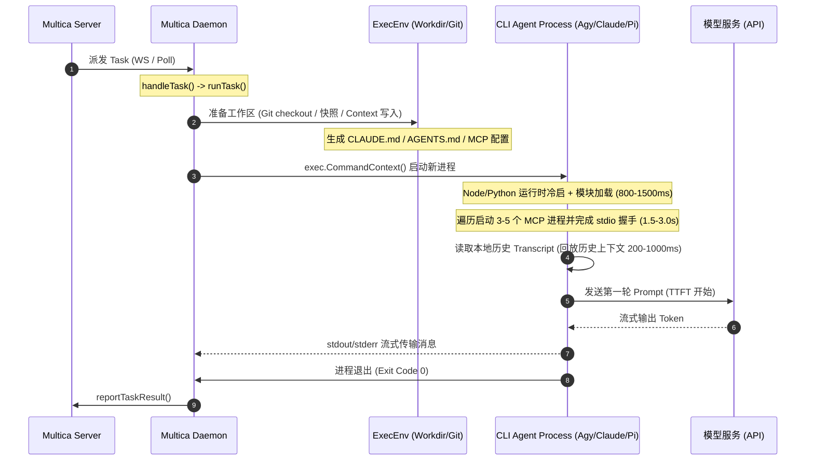
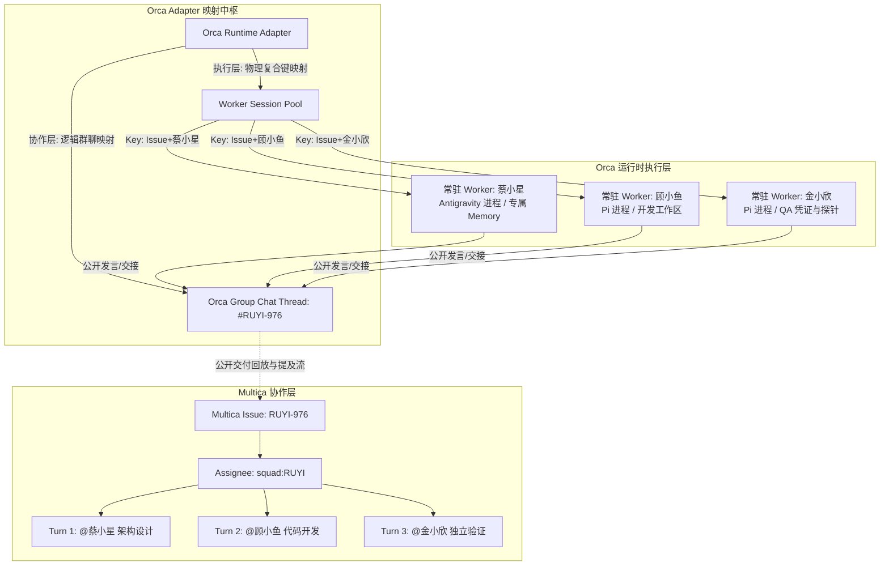
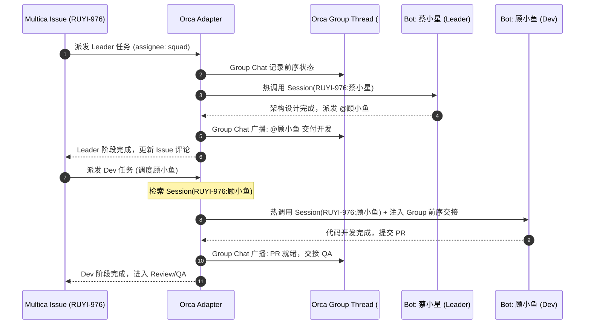
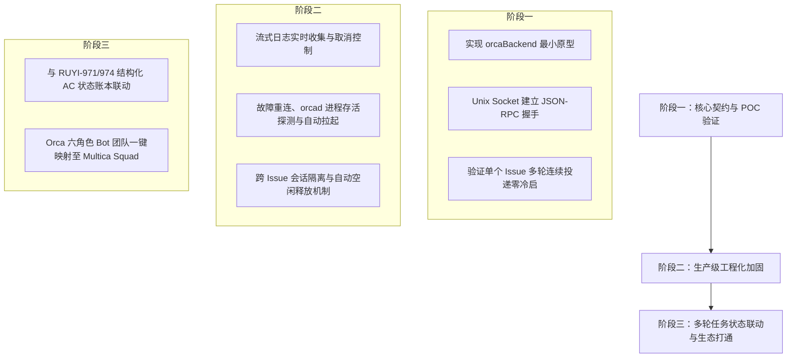

# ADR 011：Orca Bot 持续会话机制与 Multica 轻量化 Runtime 适配器架构（RUYI-976）

- 日期：2026年11月28日
- 状态：proposed（调研结论明确；推荐路线 B：新增 Orca Runtime Adapter 先行落地验证 POC，后续视效果沉淀通用会话抽象）
- 负责人：蔡小星（资深架构师 / 团队 Leader）
- 范围：Orca Bot 与 Multica Runtime 源码级机制对照、进程与会话生命周期模型、路线 A（Multica 原生长会话池）与路线 B（Orca Runtime Adapter）架构设计、调度性能基准分析、接口契约及分阶段落地演进。不包含生产级 Runtime 的非授权盲目重构。
- 关联：RUYI-976；RUYI-971/974（结构化任务状态与自主续航）；ADR-008（Run 活动可观测性）。

---

## 1. 术语纠偏与概念边界确认

### 1.1 术语校正声明
- 本单此前在创建和早期流转中出现的 **Boat / BoatOS** 属于术语拼写错误，原有表述全部作废。
- 经源码与本地环境核实，正确产品及功能名称全局统称为 **Orca Bot（B-O-T）**。

### 1.2 概念映射假设核实
Owner 提出的核心概念映射假设：
> **Multica Agent（身份、职责、记忆）≈ Orca Bot；Multica Runtime（执行后端）≈ Orca 接入的 CLI Agent**

经过对宿主机运行的 Orca 守护进程（`orcad`，PID `4153212`，版本 `0.1.0+0fd032b936f8`）及本地 14 个 Bot 配置（如 `蔡小星`、`PR 评审`、`顾小鱼` 等）的实测核对，**该假设完全成立**：

| 维度 | Multica 体系 | Orca 体系 | 源码核实证据与实现细节 |
| :--- | :--- | :--- | :--- |
| **智能体身份 (Identity)** | `Agent`（如 `蔡小星`、`顾小鱼`） | `Orca Bot`（如 `蔡小星`、`PR 评审`） | `~/.orca/bots/<slug>/bot.json` 声明 `id`, `name`, `agent`, `avatar`；`SOUL.md` 注入角色人格、职责与硬性边界。两者在业务层语义完全一致。 |
| **长期记忆 (Memory)** | 任务历史与 Clause 动态注入 | `MEMORY.md` + `memory/<topic>.md` | Bot 目录包含 `MEMORY.md`（按最新事实优先追加）与 `memory/` 专题文件；历史变更由 `bot-memory-history` 跟踪版本。 |
| **执行引擎 (Backend)** | `Runtime Provider` (`claude`, `pi`, `codex`, `antigravity` 等) | `Agent Engine` (`claude`, `pi`, `codex`, `antigravity` 等) | `bot.json` 的 `"agent"` 字段指明底层驱动引擎。两者均为最底层的模型执行与工具调用容器。 |
| **任务容器 (Container)** | `Issue` / `Task (Run)` | `Item` / `Chat Session` / `Worker Dispatch` | `bot-items.sqlite` 管理卡片任务（含 `planned`, `working`, `waiting`, `done` 等状态）；`agent-session-domain.db` 管理多轮交互。 |
| **无桌面/Headless 能力** | Daemon 原生无头常驻 | `orcad` 原生支持纯 Headless 运行 | `orcad-server.js` 证实：`orcad` 可独立于 Electron 运行，暴露 WS (`ws://127.0.0.1:6768`) 与 Unix Socket (`~/.orca/daemon/daemon-v63.sock`)，完全支持无头服务器部署。 |

### 1.3 Bot 与底层 Agent 的映射关系
1. **单一 Bot 绑定单一默认 Agent 类型**：每个 Bot 目录下的 `bot.json` 配置单一 `"agent"` 字段（如 `PR 评审` 绑定 `claude`，`蔡小星` 绑定 `antigravity`）。
2. **底层 Agent 引擎可被多个 Bot 共享**：在 `orca bot list` 实际数据中，`pi` 引擎同时服务于 `工作区清理`、`依赖更新`、`Pawn`、`黄小云`、`顾小鱼`、`金小欣`、`谢小婷` 等 7 个以上 Bot。
3. **结论**：**Orca Bot 决不能与底层 Agent/执行引擎混为一谈**。Bot 是业务层角色（Prompt + 记忆 + 状态），Agent 是通用执行器（LLM 驱动 + 工具运行时）。

---

## 2. 源码级机制剖析：会话与进程生命周期

### 2.1 三态生命周期状态机
Orca 会话并非单次临时子进程，而是具有**三级分层状态机**：
1. **Settled（任务结算）**：Worker 报告 `worker_done`，单项任务结算完成，但进程与终端**不立即销毁**。
2. **Ended（休眠态 / Dormant）**：会话进入休眠状态。终端和 CLI 进程持续驻留；再次通过 `orchestration.send` 或 `agentSession.send` 投递新 Turn 时，**直接在原进程标准输入中唤醒（热调用）**。
3. **Destroyed（彻底销毁）**：仅在显式执行 `worker-stop` / `worker-release`、空闲超时（Idle TTL）或看门狗确认异常后释放 PTY 与锁。



### 2.2 Hook 细粒度观测机制
Orca 通过注入 `claude-hook.sh`、`omp-managed-status-extension` 等 Hook 插件，通过环境变量 `ORCA_AGENT_HOOK_PORT` 和 HTTP POST 实时拦截 `SessionStart`、`PreToolUse`、`PermissionRequest`、`PostToolBatch` 等内部事件。这使得宿主程序在不侵入 Agent CLI 业务逻辑的前提下，能够以微秒级精度感知 Agent 的空闲、忙碌与挂起状态。

---

## 3. Multica 当前 Runtime 调度瓶颈与开销分解

### 3.1 当前 Multica Run 调度链路
Multica 现有架构在每个任务轮次（Run）中执行独立的冷启动流程：


### 3.2 冷启动 vs 存活会话（热调用）开销分解与实测基准

| 调度阶段 | Multica 当前机制（单轮进程冷启） | Orca 驻留 Worker（热会话调用） | 优化收益 |
| :--- | :--- | :--- | :--- |
| **1. 任务 Claim 与派发** | 50ms – 200ms | 20ms – 50ms（内部队列唤醒） | 节约 ~100ms |
| **2. 环境与配置准备** | 100ms – 400ms（全量重写 Context/MCP） | 0ms（复用已绑定的工作区与 PTY） | **节约 100–400ms** |
| **3. CLI 解释器进程 Fork** | 800ms – 1500ms（Node/Python Cold Fork） | **0ms（进程常驻内存）** | **节约 800–1500ms** |
| **4. MCP 工具握手与初始化** | 1500ms – 3000ms（多个外部进程并发握手） | **0ms（MCP 保持持久连接）** | **节约 1.5s–3.0s** |
| **5. 历史上下文恢复** | 200ms – 1000ms（从磁盘全量解析回放） | **0ms（上下文已在内存中）** | **节约 200–1000ms** |
| **6. 首 Token 延迟 (TTFT)** | 1000ms – 2500ms（含服务端 Prefix Cache 探测） | 500ms – 1500ms（命中 Server Prefix Cache） | 提速 ~30%–50% |
| **端到端总延迟** | **3.65s – 8.6s** | **0.52s – 1.6s** | **整体耗时压缩 70% – 85%** |

---

## 4. 两条技术路线深度对比与架构设计

### 4.1 路线 A：Multica 内部原生移植长会话 Worker 池
- **方案描述**：在 Multica Daemon 内部实现类似 Orca 的 `SessionWorkerPool`。为处于活动状态的 Issue / Chat 维持常驻进程池，通过持久化的 stdio / IPC 通道向 Agent CLI 发送多轮 Turn，并配套心跳、内存看门狗与空闲回收策略。
- **架构时序**：
  ```mermaid
  flowchart TD
      subgraph Multica Daemon
          TaskPoller[Task Poller] --> WorkerPool[Worker Pool / Session Manager]
          WorkerPool -->|匹配存活会话| LiveWorker[常驻 CLI Process (Claude/Pi/Agy)]
          WorkerPool -->|无存活或已超时| NewWorker[Fork 新 Worker 进程]
          LiveWorker -->|持久 stdio/JSON-RPC| AgentTurn[发送新 Turn]
          LiveWorker --> Watchdog[Idle & Memory Watchdog]
          Watchdog -->|超过 TTL| GracefulStop[优雅终止进程]
      end
  ```
- **改造清单**：
  1. `server/internal/daemon/daemon.go`：新增 `WorkerPool`，重构 `runTask` 的进程启动与回收分支。
  2. `server/pkg/agent/agent.go`：将 `Backend.Execute` 扩展为支持长连接会话的 `PersistentBackend`。
  3. 需针对每个 CLI（Claude Code, Pi, Codex, Antigravity）单独开发支持“非阻塞等待下一轮输入”的协议包装器。
- **难点与风险**：
  - 侵入性极高，工作量巨大。Multica 支持 10 余款不同的底层 CLI，各 CLI 的非阻塞 stdio 交互协议差异巨大，短期内改造成本和维护成本难以收敛。
  - 进程泄露与内存溢出风险全部集中在 Multica Daemon 自身。

---

### 4.2 路线 B：新增 Orca Runtime Adapter（推荐方案）
- **方案描述**：
  保留 Multica 现有的组织、Issue、看板、任务队列与鉴权体系，在 `server/pkg/agent/` 中新增 `orcaBackend`（实现标准 `agent.Backend` 接口）。
  当 Task 派发给配置为 `runtime_mode=orca` 的 Agent 时，Multica Daemon 通过本地 Unix Domain Socket 直接与宿主机常驻的 `orcad`（Headless 服务）通信，使用 `orchestration.send` 或 `agentSession.send` 投递任务，并由 Orca Bot 完成持续执行。

- **系统架构图**：
  ```mermaid
  flowchart LR
      subgraph Multica 协作平台
          Issue[Multica Issue] --> Run[Multica Run]
          Run --> Daemon[Multica Daemon]
          Daemon --> OrcaAdapter[pkg/agent: Orca Runtime Adapter]
      end

      subgraph Orca Headless Runtime (orcad)
          OrcaAdapter -->|Unix Socket / JSON-RPC| OrcadService[orcad Daemon (ws:6768 / sock)]
          OrcadService --> BotRouter[Orca Bot Router]
          BotRouter --> BotInstance[Orca Bot (蔡小星/顾小鱼/...)]
          BotInstance --> PersistentWorker[常驻 Worker Terminal / PTY]
          PersistentWorker --> CLIEngine[CLI Backend: Claude/Pi/Agy]
      end
  ```

- **调用时序图**：
  ```mermaid
  sequenceDiagram
      autonumber
      participant MServer as Multica Server
      participant MDaemon as Multica Daemon (OrcaAdapter)
      participant Orcad as orcad (Headless Daemon)
      participant Bot as Orca Bot / Worker

      MServer->>MDaemon: 派发 Issue Run 任务
      Note over MDaemon: 查寻 Issue 绑定的 Orca Chat UUID
      MDaemon->>Orcad: Unix Socket: agentSession.send (Chat UUID, Prompt)
      Orcad->>Bot: 唤醒常驻 Worker (热调用, 0ms 冷启)
      Bot-->>Orcad: 实时输出 Token & Tool Events
      Orcad-->>MDaemon: 流式事件回传 (stdout/stderr)
      MDaemon-->>MServer: 实时写入 Multica Task Log
      Bot->>Orcad: 任务结算 (Settled/worker_done)
      Orcad-->>MDaemon: 交付完成事件
      MDaemon->>MServer: reportTaskResult(success)
      Note over Bot: 进程持续保持 Dormant 休眠态，等待下一轮 Run
  ```

- **关键映射与契约**：
  1. **Agent 映射**：Multica Agent `Name` 或配置属性直接映射为 Orca Bot ID / 名称（如 Multica `蔡小星` -> Orca Bot `蔡小星`）。
  2. **Issue / 会话隔离**：每个 Multica Issue 映射到 Orca Bot 的一个独立 Chat Session（UUID 相互绑定并持久化记录在 Issue `metadata` 中）。同一 Issue 的多次触发自动复用该 Chat，保证上下文不丢失。
  3. **日志与取消流**：Adapter 通过订阅 Orca `agentSession.subscribeStatus` / `terminal.read` 实时采集日志流并回写 Multica Task Log；收到 Multica Cancel 时向 Orca 发送 `agentSession.cancel`。
  4. **零桌面依赖**：`orcad` 通过 `orca serve` 启动，原生纯命令行 headless 常驻，无需 Electron 窗口。

---

### 4.3 综合决策对比矩阵

| 评估维度 | 路线 A：Multica 内部原生移植持续会话 | 路线 B：新增 Orca Runtime Adapter | 架构裁决 |
| :--- | :--- | :--- | :--- |
| **开发工程量** | **极高**（需重构 Daemon 进程模型，逐个适配 10+ 款 CLI 的长连接交互） | **低至中**（仅需实现 ~600 行 Go 适配器代码，复用现有 Runtime 扩展点） | **路线 B 显著胜出** |
| **架构侵入性** | 高（影响现有所有单跑任务的清理与资源回收保证） | 极低（作为可选 Provider 接入，不影响现有 Pi/Codex/Claude 运行） | **路线 B 隔离性好** |
| **生态复用度** | 0（需重复发明 Bot 人格、记忆、Hook 拦截轮子） | **100%**（直接复用 Orca 现成的六角色 Bot 团队、SOUL、MEMORY、Skills） | **路线 B 价值最大** |
| **部署依赖** | 纯 Go 二进制，零外部依赖 | 依赖宿主机安装并启动 `orcad`（Node.js 无头常驻） | 路线 A 部署更轻 |
| **稳定性与故障域** | 内部故障域集中在 Daemon | 跨进程两级故障域（Multica Daemon + `orcad`） | 需健全的重连与熔断 |
| **冷热延迟收益** | 端到端 1.0s – 2.0s | 端到端 0.5s – 1.6s | 基本相当（均消灭了进程与 MCP 冷启） |

---

### 4.4 团队/小队与群聊多智能体兼容性架构：会话绑定契约设计

在引入团队（Team）、小队（Squad）及群聊（Group Chat）协作后，**单个 Issue 不再由单一 Agent 独占**，而是涉及多个专业角色（如 Leader 蔡小星、Dev 顾小鱼、QA 金小欣、PM 谢小婷）交替执行。若简单将 `Issue => 单一 Bot Session` 1:1 绑定，会引发严重的**身份污染**、**上下文覆写**与**模型引擎冲突**（例如顾小鱼的 Pi/Claude 引擎无法复用蔡小星的 Antigravity 进程）。

针对此问题，本架构提出**「执行层物理隔离 + 协作层群聊聚合」的双层分级绑定契约（Two-Layer Hybrid Binding）**：

#### 4.4.1 双层绑定契约设计



1. **物理执行层（Execution Layer）：复合键隔离机制**
   - **绑定规则**：底层物理 Worker Session 的 Key 为复合主键：
     $$\text{SessionKey} = \text{Issue\_ID} + \text{":"} + \text{Agent\_ID}$$
   - **运作机制**：
     - 在同一 Issue 下，各成员 Bot 拥有属于自己的常驻 Worker 进程与终端 PTY；
     - 蔡小星执行时复用 `(Issue, 蔡小星)` 的长连接会话；顾小鱼执行时复用 `(Issue, 顾小鱼)` 的长连接会话；
     - **收益**：彻底消除身份覆盖风险，保护各 Bot 专属的 `SOUL.md`、`MEMORY.md` 与底层模型引擎；各自保持独立的长存活上下文与 0ms 进程热启动能力。

2. **逻辑协作层（Collaboration Layer）：Orca 群聊（`bots.groups`）聚合机制**
   - **绑定规则**：
     - **Multica Squad / 项目空间** $\longrightarrow$ **Orca Group (`groupId`)**（如 “RUYI 工程小队”）；
     - **Multica Issue** $\longrightarrow$ **Orca Group Thread (`threadId`)**（如 “#RUYI-976 架构与调研”）；
   - **运作机制**：
     - 利用 Orca 原生的 `bots.groups.send` 与 `replyMode: "mentions"` 能力；
     - 当 Issue 中发生跨角色交接（如 Leader 蔡小星调度 `@顾小鱼`）时，Adapter 在该 Issue 对应的 Group Thread 内发布带有精准 `@顾小鱼` 提及的交接消​​息；
     - 被提及的 Bot（顾小鱼）在群聊序列中被唤醒，并在其专属物理会话中执行任务；
     - 任务执行完毕后，交付摘要与关键结论被同步写回 Group Thread。

#### 4.4.2 团队/小队调度时序流



#### 4.4.3 兼容性与边界处理策略

| 场景 | 冲突风险 | 架构解决机制 |
| :--- | :--- | :--- |
| **单 Agent 独立 Issue** | 无群聊需求，群聊开销冗余 | 降级为单 Bot 专属 Session 模式，`SessionKey = Issue_ID`，直连 Bot Chat。 |
| **Squad 多 Agent 切换** | 角色切换导致上下文与模型冲撞 | 采用 `(Issue, Agent)` 复合键物理会话池，各角色独享常驻进程，各取所需。 |
| **跨角色历史可见性** | 复合键物理会话之间无法感知彼此内部私有历史 | 通过 Orca Group Thread 汇聚各角色公开发言与交接摘要；调度新角色时将 Group Thread 最近的交接快照作为上下文输入前缀注入。 |
| **并发任务冲突** | 同一 Issue 下多个 Agent 同时被触发 | 复合物理会话天然支持并行无锁运行；Group Thread 通过递增 `sequence` 保证消息严格全序。 |
| **资源空闲回收** | 团队多角色常驻进程占用内存 | 为各物理 Worker 维持独立的 `IdleTTL`（默认 30 分钟），任务静默超期后优雅转入 `Destroyed`，释放 PTY 与内存。 |


---

## 5. 最终推荐路线与分阶段实施计划

### 5.1 决策结论
**采用「路线 B（Orca Runtime Adapter）先行落地验证 POC，后续视效果沉淀通用会话抽象」的演进策略**：
1. **优先推进路线 B**：利用 Multica 现有的 `agent.Backend` 插件化接口，以极小成本打造 `orcaBackend`，打通 Multica Issue/Run 与 Orca Bot 的持续会话能力，以真实业务验证调度提速 70%+ 的效果。
2. **完全解耦桌面**：使用 `orcad` 的纯 Headless 模式运行，验证服务器端无桌面无感集成的可行性。

### 5.2 分阶段实施计划



### 5.3 验收指标 (KPI)
1. **多轮调度延迟**：同一 Issue 下第二轮及后续 Run 的调度就绪延迟（从 Claim 到模型开始吐字）由当前平均 **4.8s 降至 < 1.2s**。
2. **上下文保留**：连续会话下上下文完整保留在内存会话中，无需重新全量读取或回放磁盘 Transcript。
3. **故障恢复**：在 `orcad` 异常重启时，Multica Adapter 具备透明重连并降级上报明确错误的能力。

### 5.4 后续任务拆分建议
- `TASK-1 (P1)`: 【POC 实现】基于 `pkg/agent/orca.go` 完成与 `orcad` 本地 Socket 的最小通信与任务投递原型。
- `TASK-2 (P1)`: 【性能实测】在标准测试用例下对比 Multica 原生与 Orca Bot 的多轮调度耗时基准数据。
- `TASK-3 (P2)`: 【生产级完善】增加日志流处理、心跳保活、中断取消与异常恢复。
