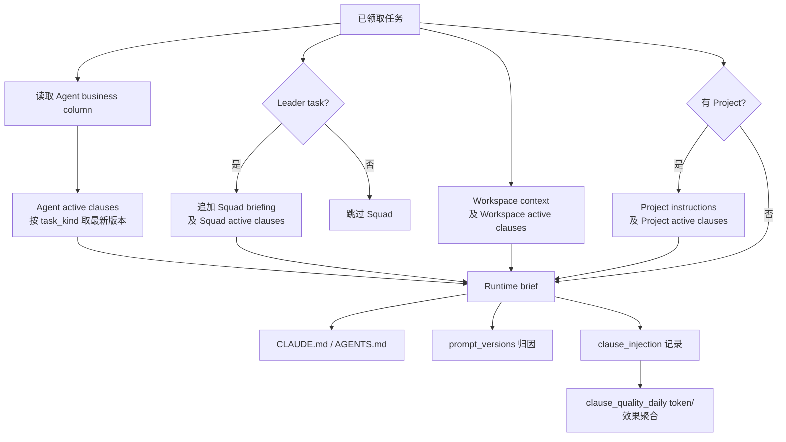

# 如意工坊提示词体系治理审计

日期：2026年11月01日

## 结论

本轮先恢复了静态人物底色，再对动态条款做可回退的去重。没有将 token 降低视为行为正确的证据。动态候选保留，但后续必须用历史案例和真实 claim 注入完成行为回归。

## 运行时组装

- 生效静态文本来自业务列；`prompt_version` 是版本与归因账本。
- 每个载体从 active binding 中按 `scope + scope_id + task_kind` 选取最新 clause，按 slug 稳定排序后渲染。
- Agent 层始终进入；Squad 层仅在当前任务是该 squad 的 Leader task 时进入，普通成员不自动继承 Squad 条款。
- 注入记录失败不阻断 claim，因此行为验收必须结合实际 Run 的 `clause_injection`、`prompt_versions` 和结果，不能只看数据库文本。

## 十月治理行为契约

| 治理线 | 已验证的要求 | 当前落点 |
|---|---|---|
| RUYI-285 | 四层 prompt、Autopilot、Skill 受版本治理；生效内容与版本历史分离 | 平台 `prompt_version` 与业务列 |
| RUYI-733 | 瘦身不能只看字符数；须对照历史行为契约与真实运行效果 | 本报告的后续行为回归门槛 |
| RUYI-737/751/764/765 | 条款是可版本化资产；按 scope/task kind 注入，迁移需保真/可回退 | `clause`/`clause_version`/`clause_binding`/`clause_injection` |
| RUYI-809 | 受管 worktree 代码任务在交付前做只读 preflight | `cls_10000031` v4 |
| RUYI-867/880/900/917 | mention 只用于立即可执行交接；无下一步静默；自 mention 按 ID 拒绝 | Workspace mention 条款与平台门禁 |
| RUYI-869/899/902 | 静态保留人物底色/稳定边界；动态规则只在确认注入后迁移；不得混淆静态编辑与运行时渲染 | 静态 copy-forward 恢复；active clause 去重候选 |
| RUYI-891 | 不得自行增加 QA/环境前置；用真实生产数据定位问题 | P0/P1/P2 与 ENV-FAULT 条款 |
| RUYI-898 | Skill 启停要按当前 Harness 实际生效核验；不能以配置存在代替行为 | `agent_skill` 读回 + 角色 Skill 索引 |
| RUYI-911/913 | 先读历史/Agent Memory/bd Memory；验证后复用；跨 Issue 知识才入 bd，失效结论要修订 | `cls_10000015` 与角色静态知识边界 |

## 当前分层

- 静态 workspace/squad/agent：人物身份、长期行事原则、稳定授权和边界。
- Workspace clauses：Owner、协作、质量/范围、授权安全、运行连续性、项目事实边界。
- Squad clauses：路由/知识沉淀、阶段状态/接管、共享现场、等待管理。
- Agent clauses：Leader、QA、研发、PM、UI、巡检、发布的运行期合同。
- Project clauses：项目专有工程事实；本轮未删除 Multica 技术快照，避免在没有专用 Skill 等价物时丢失迁移、Android、数据库和环境约束。

## 收束结果（截至 2026年11月01日初始治理）

| 项目 | 治理前 | 当前 |
|---|---:|---:|
| Active dynamic clauses | 48 | 22 |
| Workspace dynamic token 估算 | 1041 | 484 |
| Squad dynamic token 估算 | 1313 | 373 |
| Agent dynamic token 估算 | 1637 | 362 |
| Multica Project dynamic token 估算 | 1761 | 约 1721 |

截至 2026年11月01日初始治理，当时保留的 22 条 active clause 有独立版本、SHA256、active binding 和审计。被合并或作用域错位的 26 条仅停用 binding 并标记 deprecated，历史版本不删除。Multica 项目中错误绑定到所有角色的 `cls_10000026《开发规范（顾小鱼）》` 已退役，开发职责由顾小鱼的 agent 静态/动态合同承载。

## 保护性恢复

首次动态收束后，十月纠偏记录显示以下行为契约不能只依赖人格或相近措辞推定覆盖，已分别恢复到 6 条现有 active clause：

- `cls_10000015`：Leader 分派声明小队模式和状态归属；成员阶段交付的最低证据集。
- `cls_10000018`：Run `completed` 不等于阶段或 Issue 验收完成。
- `cls_10000040`：微幅直办条件、Leader 对 Owner 的简明背景/结论/证据/风险回报。
- `cls_10000046`：QA scoped `FAIL`、环境归因和现场保留/清理说明。
- `cls_10000031`：受管 worktree 代码任务退出前的 `multica worktree preflight`。
- `cls_10000063`：巡检/调查的完整性判据，禁止将部分进度当完成。

静态人物层已 copy-forward 恢复到精简前的完整内容：蔡小星保留人物底色、长期判断、工作边界和 PR 责任；QA、研发、workspace 与 squad 的稳定原文也已恢复。动态层只承载可版本化、运行期执行规则。

## 知识与 Skill 发现

所有 RUYI 角色的静态 prompt 已追加统一“知识优先与沉淀边界”而不改写人物正文：Issue 内临时状态写 Issue 评论；跨 Issue、已验证且有适用边界的经验才写 bd Memory；先检索既有知识/项目规则/已启用 Skill，只有它们都不能给出可验证路径时才设计受控探索。

已为角色建立实际绑定的 Skill 场景索引：Leader 使用 `guxy-harness-update-prompt`、`guxy-adr` 和资源/AVD Skill；QA 使用 `guxy-bug-analysis` 和资源/AVD Skill，实现型 `guxy-evidence-bugfix` 已停用；研发使用 `guxy-backend-debug`、`guxy-evidence-bugfix` 和资源/AVD Skill；白小巡只使用 `guxy-bug-analysis`，资源写操作 Skill 已停用。PM、设计、发布未绑定虚构 Skill，只提示使用当前运行时实际可见能力。

`resource-pool-qa` 和 `vm-avd-e2e` 的描述已补充 VM、租约、制品交接、Android+后端联合验收、跨端一致性和 fixture 等触发词；正文已去除 `RUYI-903` 专属标题。

## RUYI-903 后续防坑

以 RUYI-903 的真实链路反查后，已补齐以下跨 Issue 规则：

- P0/P1 验收闭环后，P2 进入台账与 `in_review` 决策，不能为 P2、历史补证或无当前 delta 的推演无限保留/重建 VM、AVD 与完整 E2E。
- 每个阶段边界和跨 Run 交接必须读回 VM/AVD 租约状态与 TTL，交接记录写明下一责任人、版本、fixture 基线、未覆盖 P0/P1、续租责任和释放条件。
- `expired`/`reclaimed` 不是计划性清理证据；资源在已定义 P0/P1 范围结束后由责任人主动释放。
- AVD、VM 与联合 E2E Skill 已统一上述边界，避免同一任务一边要求保留现场、一边按任务结束盲目释放。

仍需在真实任务中观察：Leader 是否真的按 P0/P1/P2 结束环境验证，成员交接是否把状态责任、租约责任和证据位置一次性带给下一阶段。

## 最终深度 Review 修复

最终 Review 发现并修复了以下确定性问题：

- **Task kind 误注入**：原 23 条 active binding 全部无条件，Issue 专属状态、PR、P0/P1/P2 和 worktree 规则会进入 chat、autopilot、quick-create。现已按 `task_kinds` 分流：角色/squad Issue 工作流仅进入 `issue`；Multica 项目工程条款进入 `issue/chat/autopilot`、排除 quick-create；workspace 仅保留 Owner、安全、项目边界等通用规则无条件注入。
- **静态/动态重复**：workspace、squad、Leader、QA、研发静态 prompt 中重复的 P0/P1/P2、接管、delta 和缺陷分级章节已移除。静态层从已验证人物版本重建，只保留人物底色、长期边界及收窄后的知识/Skill 索引。
- **知识检索过度前置**：由“每个 Issue 开工强制检索”改为遇阻、重复/已知问题、引用既有裁定或准备高风险/高成本探索时检索；普通目标清晰任务不为空形式全库搜索。
- **Skill 角色冲突**：QA 已停用实现型 `guxy-evidence-bugfix`；白小巡已停用 `android-avd-qa`、`resource-pool-qa`、`vm-avd-e2e`，保持只读巡检。研发可使用资源 Skill 做开发自证与交接，但不得替代独立 QA。
- **资源 Skill 前后冲突**：统一 P0/P1 现场保留、P2 不占池、跨 Run 续租责任、主动释放和 `ENV-FAULT` 非等待型收尾；三个资源 Skill 的描述已明确互斥使用场景。
- **治理通道冲突**：`guxy-harness-update-prompt` 已增加 Owner 明确授权下的受控数据库维护例外：版本断言、单事务、append-only 历史、ROLLBACK 演练和新连接回读均为必需条件。

当前选择集回读：quick-create 只接收 3 条 workspace 通用 clause，不再接收 squad、agent 或 Multica project 工作流；Leader/QA/研发运行期条款只在 issue task 注入。

## 行为回归待办

动态去重候选仍需在真实/隔离任务中验证：

1. Leader 无下一步时静默，真实下一步才 mention；错误自 mention 被机械门禁拒绝。
2. 成员仅向 Leader 回报，Leader 管理 squad Issue 状态。
3. P0/P1/P2 收束、接管触发和 token/run 阶段采样不会增加空转。
4. Dev `worktree preflight`、QA scoped FAIL、巡检不把部分进度当完成。
5. 角色能在真实任务中按场景调用已绑定 Skill，并在既有知识无法解决时才做受控探索。

未新建伪造 Agent Run；下一次真实 claim 应回读 `agent_task_queue.prompt_versions`、`clause_injection` 与实际结果作为运行时验证证据。

## RUYI-915 决策卡退化修复

核查结论：修复前当前版本未覆盖决策卡。`cls_10000002` v4 含完整决策卡契约；2026-10-31 08:22 的 v5（RUYI-911 "correct mention semantics and normalize dynamic carrier state"）只保留 mention 规则。RUYI-914 的 Run `01a18f68-47c0-74be-b986-282451de6ee0` 的 `clause_injection` 实际注入的即为 v5。静态提示词与 runtime brief 均无决策卡引导，RUYI-915 的代码提交 `6be1619130da...` 从未合入仓库。

2026-11-01 晚完成：

- `cls_10000002` 追加 v7（`owner_direct_revision`，1089 字，SHA256 `10e39cee2833...`；v6 为同一内容的中间版本，仅用于补入可量化约束）：保留 v5 原文，补回精简版决策卡契约，覆盖开卡门槛、`decision list` 查重、`decision add` 创建与回读、五键 `context` 写法、禁止以评论替代，并要求除 `facts.evidence` 外每字段 1–3 句、整卡不超过 600 字。binding 保持 workspace + `task_kinds=["issue"]`，`since_clause_version=7`；v5 及历史版本未修改。
- `runtime_config_sections.go` 的 Available Commands 增加 `multica issue decision list/add`；新增 `runtime_config_decision_commands_test.go` 回归断言。
- 验证：`go test ./internal/daemon/execenv -count=1` 通过；数据库写入经 ROLLBACK 演练、单事务提交和新连接回读，v5 哈希未变。

2026年11月02日回验：runtime brief 改动已由 PR #550 合并、重建并重启生产 daemon；真实 RUYI-915 Run 的 `clause_injection` 为 `cls_10000002` v7，运行时 `CLAUDE.md` 同时包含 `multica issue decision list/add`。原“未提交、未部署”状态已关闭。

## 2026年11月03日 P1/P2-1 修复追记

后续全量回溯发现，v7 虽恢复了决策卡正文，但 mention 与决策卡仍共用一个版本生命周期；Leader 的防拆单、知识、轮次经济和接管阈值又只在部分 `is_leader_task=true` Run 中可见。现已按独立失败域修复生产真源：

- 退役混合 Clause `cls_10000002`、`cls_10000004`、`cls_10000015`、`cls_10000018` 的 active binding，历史版本保留；创建 `cls_10000064`～`cls_10000078` 共 15 条原子 Clause。active clause 从 22 条变为 33 条，增加来自规则拆分而非新增行为。
- mention、决策卡、交付证据、中文文本、P0/P1/P2、跨角色交付和代码连续交付分别使用 workspace binding；职责路由、知识、防拆单、阶段交付/状态、轮次经济、接管阈值和完成判据绑定蔡小星 agent，覆盖其所有 issue Run。
- `cls_10000021《等待期调度》` 从 squad binding 迁到蔡小星 agent binding；原 binding 仅置 `withdrawn`，正文版本未改。
- 决策卡长度口径明确为问题、全部选项和 `context` 的面向 Owner 展示正文合计不超过 600 个 Unicode 字符，证据中的 URL、Issue/PR 标识和 commit SHA 不计；`unknowns` 必须存在，无未知项用空数组。
- 平台实际下发的 `guxy-harness-update-prompt` 已从旧 Git `snapshot/restore` 协议升级到完整 v7：以 Multica 平台 prompt/Clause 为唯一权威，保留 Owner 明确授权下的受控数据库维护例外；description、正文和两个 supporting files 与本机当前版本一致。v5/v6 是同一事务批次中修正正文截断和 description 精确一致性的 append-only 中间版本。
- 内建 Squad Operating Protocol 的“必须派发、派发后立即停工、通常不得自己实现”冲突已在代码中改为 direct/delegate/no-action 三路径，并允许授权微幅直办和接管；最终 activity 在路径完成或失败后记录。quick-create 改用 create-only 专用协议，不再接收 issue-bound activity/status/comment/mention 要求。该项需随本次代码 PR 合并、重建 daemon 后才进入生产 runtime。

上述生产数据库写入均经过同脚本 `ROLLBACK` 演练、版本/SHA 基线断言、单事务提交和新连接回读。完整证据与剩余行为回归见 `docs/ruyi-prompt-governance-full-audit-2026-11-02.md`。
